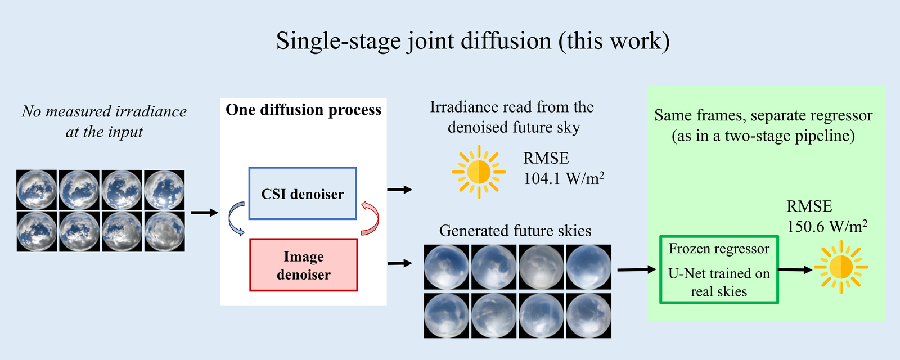

# Single-stage joint diffusion for ultra-short-term irradiance forecasting

Code, trained weights and stored forecasts for:

> K. Suwandee and S. Suwanwimolkul. *Single-stage joint diffusion of sky images and clear-sky index for ultra-short-term irradiance forecasting: what the frame-to-irradiance stage discards.* Submitted to Applied Energy, 2026.
> https://www.researchgate.net/publication/414963178 (ResearchGate)

The model forecasts the next sixteen minutes of sky images and clear-sky index together, in one diffusion
process, from eight past sky images and no measured irradiance at the input. This repository reproduces the
paper's comparison of the proposed model against twelve baseline configurations (Table 2).



*Single-stage joint diffusion. The clear-sky-index denoiser reads the denoised future sky inside one diffusion
process (pooled RMSE 104.1 W/m²); a separately trained regressor reading the same generated frames reaches
150.6 W/m². RMSEs are over the 1998-window matched 2023 test subset; the frames shown are one ramp-up case
(2023-04-01 14:06).*

## What is here

| Path | Contents |
|---|---|
| `models/`, `losses/`, `main.py`, `exp_valid.py`, `train.py`, `train/` | the proposed model and every baseline in the comparison |
| `utils/` | shared helper code used by the models and scripts |
| `configs/` | one configuration per method |
| `weights/` | download instructions and checksums for the trained weights of every method; see `weights/README.md` |
| `prediction_samples/` | the stored forecasts behind Table 2 (downloaded separately) and the tables they are checked against; see below and `prediction_samples/README.md` |
| `eval/` | `reproduce_comparison.py` (checks every cell of Table 2), `run_config.py` (runs one configuration), `check_synthetic.py` (runs every method on the synthetic set), `check_window_alignment.py` and `make_subset_indices.py` |
| `preprocessing/` | fetches SIRTA's raw files and builds the dataset; see `preprocessing/README.md` |
| `splits/sirta_2023/` | the training, validation and test lists used in the paper, and `test_window_timestamps.csv` (each of the 1998 test windows' 16 frame timestamps, Europe/Paris local time as in `test_subset_ids.csv`, for `eval/check_window_alignment.py`) |
| `samples/` | `synthetic_2023/` is shipped: a small synthetic set for trying the code without SIRTA data; `sirta_2023/` is not shipped and is built from SIRTA's files |
| `environment.yml`, `requirements.txt` | the software environment (conda and pip) |
| `LICENSE`, `NOTICE`, `LICENSES/` | the licence of this code, and the credits and licences of third-party code and weights |
| `PORTING_NOTES.md` | how the release was assembled, and every known discrepancy |

### The reference files in `prediction_samples/`

| File | What it is | Why it is here |
|---|---|---|
| `expected_table2.csv` | every cell of Table 2 (RMSE, FS, CRPS, CRPSS and their 95 % intervals) on the paper's 1998 test samples, at full precision | the scoring script compares your result against it, cell by cell |
| `expected_rebuild.csv` | the same table computed on 1912 of those samples | SIRTA re-issued its 2023 irradiance files in February 2025 and marked some minutes that were provisional in the paper's copy as unusable; a dataset built from today's files therefore lacks 86 test samples. The script uses this table when it detects that case, so a recent download can still be checked exactly |
| `rebuild_excluded.csv` | the 86 test samples missing from a dataset built from today's files, by timestamp | lets the script recognise that case, and lets you see which samples are affected |
| `expected_synthetic.csv` | point scores (RMSE, FS, CRPS, CRPSS) of the methods that run on `samples/synthetic_2023`, with the smart-persistence reference and per-method tolerances; no intervals, no Xiong | `eval/check_synthetic.py` compares your runs against it, method by method; a consistency check, not a performance result |
| `CHECKSUMS.tsv`, `MANIFEST.tsv` | hashes and contents of the downloadable forecast files | to verify the download |

## Quick start

1. **Environment.** `conda env create -f environment.yml` (PyTorch with CUDA; tested on one RTX 4090).
2. **Weights.** Download the trained weights and check their checksums as described in `weights/README.md`.

**Try it on synthetic data.** SIRTA's data is not redistributed, but a small synthetic set is: 24 windows
over three 2023 days, images generated by a diffusion model trained on SIRTA 2023 images, invented
irradiance, timestamps on odd minutes (not real observations). Nothing needs to be requested from SIRTA.

**Approach 1. Run with our script.**
```
python eval/run_config.py --config configs/samples/synthetic/propFuture.yaml --like propFuture
```
This stages the checkpoint itself and writes to `outputs/` (gitignored). The scores it prints are not
meaningful -- this only demonstrates that the pipeline runs. See `samples/synthetic_2023/README.md` for
what the set contains and how it was made.

To run every method on this set at once and check that each still runs correctly on your machine:
```
python eval/check_synthetic.py
```
This runs every method and compares the result with `prediction_samples/expected_synthetic.csv`: EXACT is
expected on hardware and software like ours, CLOSE on others -- both mean the method runs correctly. A
consistency check only, not a measure of performance; see the table in `samples/synthetic_2023/README.md`.

**Approach 2. Run with `main.py`.** For readers new to the code, the same run can be made directly instead.
`run_config.py` stages the checkpoint automatically; `main.py` does not, so do that once first:
```
mkdir -p outputs/Text2ImageJoint-X0HAT_pretrained/seed1/checkpoints
cp weights/proposed_joint_future_sky_seed1_ep0959.pth \
   outputs/Text2ImageJoint-X0HAT_pretrained/seed1/checkpoints/context_joint-0959.pth
```
then set `main.py`'s one config line and run it:
```
file_h5 = process(config_file = "configs/samples/synthetic/propFuture.yaml")
file_h5.main()
```
```
python main.py
```
This produces the same forecasts as the `run_config.py` command in Approach 1, in `outputs/`.

The scores these runs print are not comparable with the paper. The set's irradiance is invented as smooth
curves, so on its steady windows methods that read the irradiance history, including smart persistence, are
almost exact, and only the ramp windows are hard. Xiong does not run on this set: it fits its
observation-noise term on the validation split, which the set leaves empty.

## Reproduce Table 2

1. **Data.** SIRTA's data is not redistributed. **Follow `preprocessing/README.md`**: it explains how to request
   FTP access from SIRTA, download the 2023 irradiance files and sky images (about 45 GB), and run the build
   steps in order, and what to expect from a rebuild. The result is a folder named
   `sirta_2023_image64-localtime_ICHP-daytime-dhi`, placed or linked in the repository root.
2. **Stored forecasts.** Download them as described in `prediction_samples/README.md`.
3. **Score.**
   ```
   python eval/reproduce_comparison.py
   ```
   This scores every method's stored forecasts against your ground truth and compares every cell of Table 2
   with `prediction_samples/expected_table2.csv`. It should end with `183/183 cells PASS`. If your SIRTA
   download is recent, your dataset lacks the 86 samples in `rebuild_excluded.csv`; the script detects this and
   checks against `expected_rebuild.csv` instead, which should also pass on every cell. On any other sample
   set it lists the missing samples and does not report a match.

**A rebuilt window can shift even when it isn't excluded.** The 86 excluded samples aren't the whole story:
some of the other 1912 are built from shifted input or target frames while still keeping their test_id
(see `PORTING_NOTES.md`, "Data", for what causes this and how often it happens). To see exactly which of
the 1998 canonical windows your own build matches frame for frame, run this against the folder from Data
above, once it's placed or linked in the repository root as that step describes:
```
python eval/check_window_alignment.py --data-folder sirta_2023_image64-localtime_ICHP-daytime-dhi
```
Scores computed from a shifted window are not directly comparable to ours one to one.

**Regenerating the forecasts** from the weights instead of scoring the stored ones: download the weights
(`weights/README.md`), then

```
python eval/reproduce_comparison.py --mode regenerate [--rows SunSet,Xiong] [--force]
```

Deterministic methods reproduce exactly, and so does the proposed model on both its arms, given the same
data, subset order and batch size. SkyGPT's sampler is unseeded and Xiong's forward pass is not bit-for-bit
deterministic, so their ensembles change from run to run; regenerated scores fall within the confidence
intervals of Table 2. See `PORTING_NOTES.md`. To run a model on a chosen set of test
windows, `eval/make_subset_indices.py` selects them by timestamp; see
`configs/samples/joint_x0hat_sample2023.yaml` for an example.

**Run one configuration.** `eval/reproduce_comparison.py --mode regenerate` runs the fixed set of rows behind
Table 2; to run a single config on its own (for example the sample config above), instead:

```
python eval/run_config.py --config configs/samples/joint_x0hat_sample2023.yaml --like propFuture
```

Output goes to `outputs/` (gitignored), not `results/` -- `results/` is where `--mode regenerate` writes, and
this script never touches it.

The RMSE a run prints does not always match Table 2's: for the proposed model and Xiong, the printout is
the mean of per-horizon RMSEs, while Table 2 (`eval/score.py`, as used by `eval/reproduce_comparison.py`)
pools every error under one square root; every other method that prints an RMSE already equals that pooled
value.

For readers new to the code, the same run can be made directly from `main.py` instead. `run_config.py` stages
the checkpoint automatically; `main.py` does not, so do that once first:
```
mkdir -p outputs/Text2ImageJoint-X0HAT_pretrained/seed1/checkpoints
cp weights/proposed_joint_future_sky_seed1_ep0959.pth \
   outputs/Text2ImageJoint-X0HAT_pretrained/seed1/checkpoints/context_joint-0959.pth
```
then set `main.py`'s one config line and run it:
```
file_h5 = process(config_file = "configs/samples/joint_x0hat_sample2023.yaml")
file_h5.main()
```
```
python main.py
```
This produces the same forecasts as the `run_config.py` command above, in `outputs/`.

**Training** code is included for every method but has been verified in this repository for inference only.

## Citation

The paper is available as a preprint: https://www.researchgate.net/publication/414963178

```bibtex
@misc{suwandee2026singlestage,
  author       = {Suwandee, Kanawut and Suwanwimolkul, Suwichaya},
  title        = {Single-stage joint diffusion of sky images and clear-sky index for
                  ultra-short-term irradiance forecasting: what the frame-to-irradiance
                  stage discards},
  year         = {2026},
  howpublished = {Preprint, ResearchGate},
  url          = {https://www.researchgate.net/publication/414963178}
}
```

## Licence

The code is licensed under the Apache License 2.0 (`LICENSE`). Third-party code and the proposed model's
weights, which derive from Stable Diffusion v1-5 and are under the CreativeML Open RAIL-M licence, are listed
with their licences in `NOTICE`; full texts are in `LICENSES/`.

## Data and acknowledgement

The sky images and irradiance measurements come from the SIRTA atmospheric observatory and are subject to its
data policy. The authors would like to acknowledge SIRTA for providing the data used in this study. Please cite:

Haeffelin, M., et al. (2005). SIRTA, a ground-based atmospheric observatory for cloud and aerosol research.
*Annales Geophysicae*, 23(2), 253–275. https://doi.org/10.5194/angeo-23-253-2005

## Funding

This work was supported by the 111th Anniversary Engineering Research Catalyst Fund Towards U Top 100,
Chulalongkorn University.
